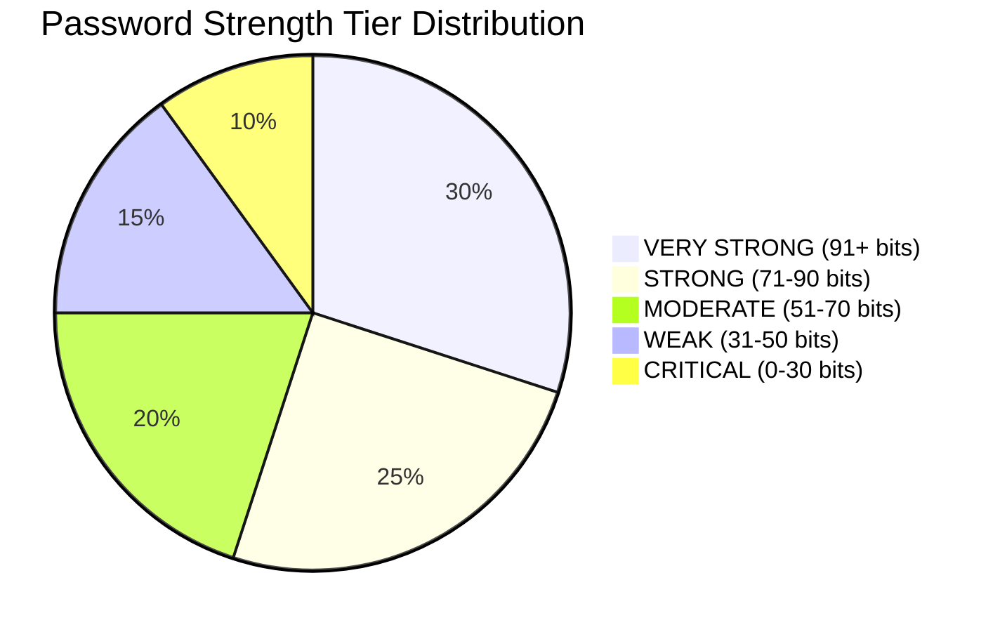
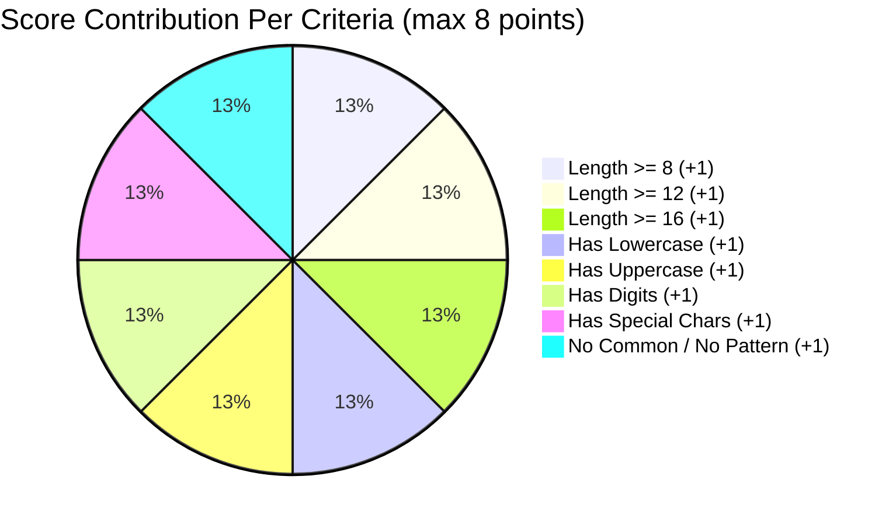
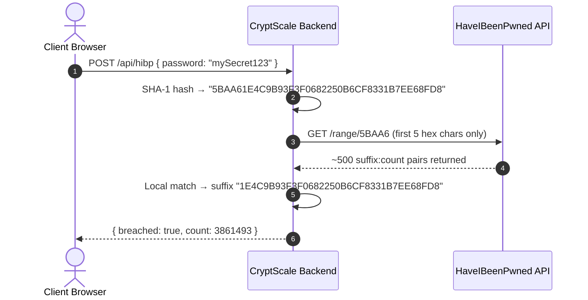
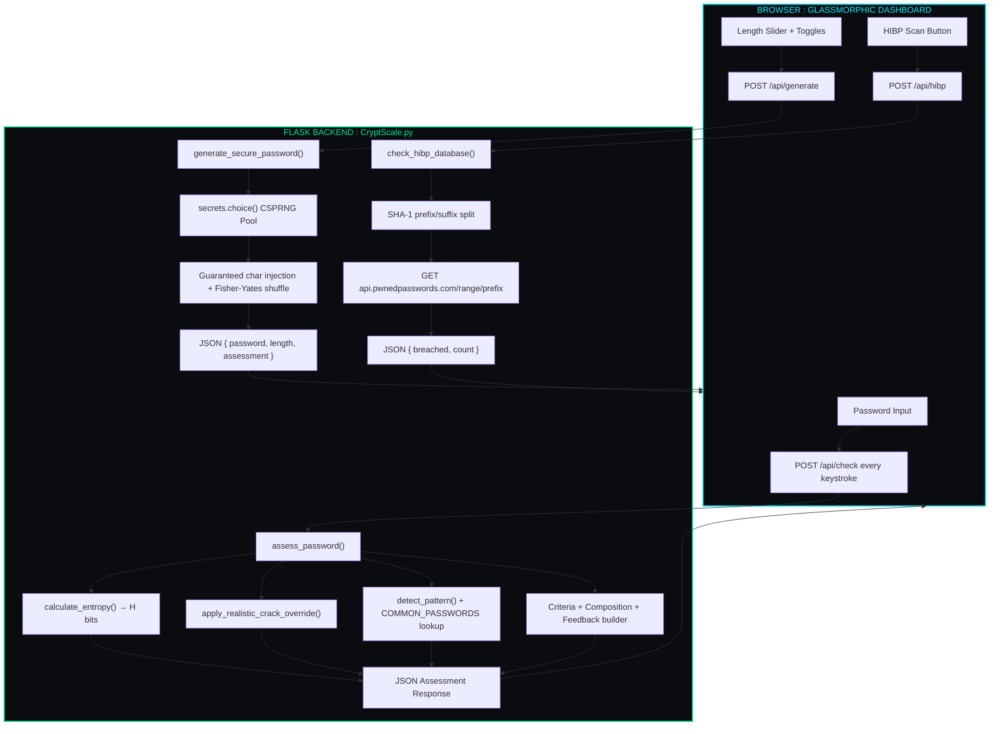

<div align="center">

<h1 style="font-family: 'Cooper Black', 'Arial Black', serif; font-size: 4rem; letter-spacing: 2px; color: #00f0ff; margin-bottom: 2px; text-shadow: 0 0 25px rgba(0, 240, 255, 0.45);">
  🛡️ CRYPTSCALE 🛡️
</h1>

<h3 style="font-family: 'Bookman Old Style', 'URW Bookman', 'Georgia', serif; font-weight: 500; color: #00e599; margin-top: 6px; letter-spacing: 0.8px;">
  ◈ <i>Next-Gen Password Complexity Auditor &amp; CSPRNG Security Engine</i> ◈
</h3>

<br/>

[](https://python.org)
[](https://flask.palletsprojects.com/)
[](https://haveibeenpwned.com/)
[](#)
[](LICENSE)

<br/>

<p align="center" style="font-family: 'Bookman Old Style', 'URW Bookman', serif; font-size: 1.05rem;">
  <b>✦ <a href="#01-system-overview">Overview</a> ✦</b> &nbsp;•&nbsp;
  <b>✦ <a href="#02-ui-preview">UI Preview</a> ✦</b> &nbsp;•&nbsp;
  <b>✦ <a href="#03-telemetry-metrics--charts">Metrics &amp; Charts</a> ✦</b> &nbsp;•&nbsp;
  <b>✦ <a href="#04-the-science--math">Science &amp; Math</a> ✦</b> &nbsp;•&nbsp;
  <b>✦ <a href="#05-system-architecture">Architecture</a> ✦</b> &nbsp;•&nbsp;
  <b>✦ <a href="#06-quick-start">Quick Start</a> ✦</b> &nbsp;•&nbsp;
  <b>✦ <a href="#07-api-endpoints">API Endpoints</a> ✦</b> &nbsp;•&nbsp;
  <b>✦ <a href="#08-cli-reference">CLI Reference</a> ✦</b>
</p>

---

</div>

<h2 id="01-system-overview" style="font-family: 'Bookman Old Style', 'URW Bookman', 'Georgia', serif; color: #00f0ff;">🌌 01. System Overview</h2>

<p style="font-family: 'Bookman Old Style', 'URW Bookman', serif; font-size: 1.05rem; line-height: 1.7;">
<b>CryptScale</b> is a full-stack password intelligence platform built with <b>Python</b>, <b>Flask</b>, and the <b>secrets</b> CSPRNG module. It delivers real-time entropy analysis, GPU-class crack-time simulation, and zero-knowledge breach detection — all wrapped in a cyberpunk glassmorphic web dashboard running on port <code>5001</code>.
</p>

```
  ┌─────────────────────────┐      ┌─────────────────────────┐      ┌─────────────────────────┐
  │  ⌨️  Browser Input      │ ──❯  │ 🧠 assess_password()   │ ──❯  │ 🖥️  Flask Dashboard     │
  │   (REST POST /api/check)│      │  Entropy · Score · HIBP │      │     (127.0.0.1:5001)    │
  └─────────────────────────┘      └─────────────────────────┘      └─────────────────────────┘
```

> [!NOTE]
> **Dual-Mode Operation**: CryptScale runs as a **web dashboard** (`python CryptScale.py`) *or* as a **headless CLI** (`--check`, `--generate`, `--hibp`) for CI/CD pipelines and shell scripts.

---

<h2 id="02-ui-preview" style="font-family: 'Bookman Old Style', 'URW Bookman', 'Georgia', serif; color: #00f0ff;">📸 02. UI Preview</h2>

<div align="center">

<kbd>
  
</kbd>

<br/>
<sub style="font-family: 'Bookman Old Style', 'URW Bookman', serif;"><b>◈ Figure 1.0:</b> Real-Time Password Auditor — entropy gauge, strength ring, 9-point criteria checklist, and live composition chart.</sub>

</div>

<br/>

<div align="center">

<kbd>
  
</kbd>

<br/>
<sub style="font-family: 'Bookman Old Style', 'URW Bookman', serif;"><b>◈ Figure 2.0:</b> Advanced CSPRNG Generator — length slider (8–20), preset buttons, character-class toggles, and ambiguous-char exclusion filter.</sub>

</div>

<br/>

<div align="center">

<kbd>
  
</kbd>

<br/>
<sub style="font-family: 'Bookman Old Style', 'URW Bookman', serif;"><b>◈ Figure 3.0:</b> CRITICAL strength tier alert with GPU crack-time, web crack-time, and HIBP k-Anonymity breach scanner output.</sub>

</div>

---

<h2 id="03-telemetry-metrics--charts" style="font-family: 'Bookman Old Style', 'URW Bookman', 'Georgia', serif; color: #00f0ff;">📊 03. Telemetry Metrics &amp; Charts</h2>

### 🥧 Strength Tier Distribution (Typical Audit Pool)


### 🛰️ Scoring Subsystem Weights


---

<h2 id="04-the-science--math" style="font-family: 'Bookman Old Style', 'URW Bookman', 'Georgia', serif; color: #00f0ff;">🔬 04. The Science &amp; Math</h2>

### 🔢 Shannon Character-Pool Entropy

Entropy measures a password's unpredictability in bits:

$$H = L \times \log_2(R)$$

Where:
- **$L$** = Length of the password string
- **$R$** = Active character pool size, built by summing present character classes:

| Character Class | Detection Condition | Pool Addition |
| :--- | :--- | :---: |
| Lowercase ($a$–$z$) | `re.search(r"[a-z]", pwd)` | **+26** |
| Uppercase ($A$–$Z$) | `re.search(r"[A-Z]", pwd)` | **+26** |
| Digits ($0$–$9$) | `re.search(r"\d", pwd)` | **+10** |
| Special punctuation | `re.search(string.punctuation, pwd)` | **+32** |
| Whitespace | `re.search(r"\s", pwd)` | **+1** |

#### 🎯 Strength Tier Classification:
```text
  [  0 - 30 bits ]  ──❯  CRITICAL      #ff3b5c  (Crackable in milliseconds)
  [ 31 - 50 bits ]  ──❯  WEAK          #ff7a3d  (Vulnerable to desktop GPUs)
  [ 51 - 70 bits ]  ──❯  MODERATE      #ffb800  (Decent defense against casual attackers)
  [ 71 - 90 bits ]  ──❯  STRONG        #00e599  (Immune to single GPU clusters)
  [   91+ bits   ]  ──❯  VERY STRONG   #00f0ff  (Cryptographically solid / Centuries+)
```

---

### ⚡ GPU vs. Web Attack Crack-Time Estimation

CryptScale models two distinct real-world threat vectors:

| Attack Vector | Speed | Formula | Scenario |
| :--- | :---: | :--- | :--- |
| **Offline GPU Brute-Force** | $10^{10}$ guesses/sec | seconds = $2^H$ / 10,000,000,000 | Multi-RTX 4090 Hashcat rig |
| **Online Throttled Web** | $100$ guesses/sec | seconds = $2^H$ / 100 | Rate-limited login endpoint |

> [!TIP]
> **Realistic Override**: For dictionary passwords (`is_common = True`), the crack-time is immediately forced to `< 1 second` — because real attackers use wordlists, not random guessing. Keyboard-walk patterns (`has_pattern = True`) are clamped to an effective entropy of **~17 bits** (~100,000 candidates).

---

### 🔐 Zero-Knowledge $k$-Anonymity Breach Verification

Your password is **never sent over the network**. CryptScale implements the industry-standard $k$-Anonymity protocol:



> [!IMPORTANT]
> Only the **first 5 characters** of the SHA-1 hash ever leave your machine. The full hash is never transmitted — this query is anonymous by design.

---

<h2 id="05-system-architecture" style="font-family: 'Bookman Old Style', 'URW Bookman', 'Georgia', serif; color: #00f0ff;">🧬 05. System Architecture</h2>



### 📁 Project Structure

```text
CryptScale/
├── templates/
│   ├── index.html         ← Semantic HTML5 dashboard (glassmorphic layout)
│   ├── admin_login.html   ← Secure admin authentication portal
│   ├── admin_dashboard.html ← Security control & telemetry dashboard
│   └── 429.html           ← Rate limiting defense fallback
├── static/
│   ├── css/
│   │   └── style.css      ← Cyberpunk ambient glow & SVG ring gauge styles
│   └── js/
│       └── app.js         ← Reactive UI controller & REST client
├── ss/                    ← UI screenshots
├── CryptScale.py          ← Core Flask API, scoring engine, CLI, HIBP client
├── test_security.py       ← Automated security verification suite
├── .env.example           ← Environment configuration template
├── .gitignore             ← Security ignores (prevent secret leaks)
├── requirements.txt       ← Flask, requests, flask-limiter, flask-cors, etc.
└── README.md              ← This document
```

---

<h2 id="06-quick-start" style="font-family: 'Bookman Old Style', 'URW Bookman', 'Georgia', serif; color: #00f0ff;">🚀 06. Quick Start</h2>

### 📋 Prerequisites
- **Python 3.10+**
- Internet connection (required for HIBP breach lookups)

```bash
# 1. Install dependencies
pip install -r requirements.txt

# 2. Launch the web dashboard
python CryptScale.py
```

### 🌐 Accessing the Dashboard
- **Local machine**: `http://127.0.0.1:5001`
- **LAN devices**: `http://<YOUR_LOCAL_IP>:5001`

---

<h2 id="07-api-endpoints" style="font-family: 'Bookman Old Style', 'URW Bookman', 'Georgia', serif; color: #00f0ff;">🔌 07. REST API Endpoints</h2>

<details open>
<summary><b>🔍 <code>POST /api/check</code> — Real-Time Password Audit</b></summary>

Evaluates entropy, score, criteria, composition, crack-times, and feedback on every keystroke.

**Request:**
```json
{ "password": "Tr0ub4dor&3" }
```

**Response:**
```json
{
  "rating": "STRONG",
  "subtitle": "Strong Armor",
  "color": "#00e599",
  "tier": 3,
  "score": 7,
  "max_score": 8,
  "score_pct": 87,
  "entropy": 72.3,
  "crack_time": "~14 years",
  "crack_time_online": "Centuries+",
  "criteria": {
    "len_8": true, "len_12": false, "len_16": false,
    "has_lower": true, "has_upper": true, "has_digit": true,
    "has_special": true, "not_common": true, "no_pattern": true
  },
  "composition": { "lower": 6, "upper": 1, "digits": 1, "symbols": 1, "length": 9 },
  "feedback": ["Recommendation: Increase length to 12-20 characters for higher entropy."]
}
```
</details>

<details open>
<summary><b>🎲 <code>POST /api/generate</code> — CSPRNG Password Generator</b></summary>

Generates a cryptographically secure password strictly bounded between **8 and 20 characters**.

**Request:**
```json
{
  "length": 16,
  "include_upper": true,
  "include_lower": true,
  "include_digits": true,
  "include_symbols": true,
  "exclude_ambiguous": false
}
```

**Response:**
```json
{
  "password": "kR!9vZx#mN2@qLwT",
  "length": 16,
  "assessment": { "rating": "VERY STRONG", "entropy": 104.8, "score": 8 }
}
```
</details>

<details open>
<summary><b>🛡️ <code>POST /api/hibp</code> — k-Anonymity Breach Scanner</b></summary>

Checks the password against 800M+ compromised entries without transmitting plaintext.

**Request:**
```json
{ "password": "password123" }
```

**Response (breached):**
```json
{ "breached": true, "count": 3861493 }
```

**Response (safe):**
```json
{ "breached": false, "count": 0 }
```
</details>

<details open>
<summary><b>🔒 <code>GET /admin/dashboard</code> &amp; <code>GET /admin/api/status</code> — Admin Security Portal</b></summary>

Protected by RBAC authorization, session authentication, and PBKDF2-SHA256 password hashing. Unauthorized requests redirect to `/admin/login` or return 401.

**Response (`GET /admin/api/status`):**
```json
{
  "status": "healthy",
  "security": {
    "debug_mode": false,
    "rate_limiting": true,
    "security_headers": true,
    "cors_configured": true,
    "password_hashing": "pbkdf2:sha256",
    "csrf_protection": true
  }
}
```
</details>

---

<h2 id="08-cli-reference" style="font-family: 'Bookman Old Style', 'URW Bookman', 'Georgia', serif; color: #00f0ff;">💻 08. CLI Reference</h2>

<p style="font-family: 'Bookman Old Style', 'URW Bookman', serif; font-size: 1.02rem;">
CryptScale operates fully headless via <code>argparse</code> — ideal for scripts, CI/CD pipelines, and batch auditing.
</p>

| Flag | Type | Description |
| :--- | :---: | :--- |
| `--check "PASSWORD"` | `str` | Audit a password's strength and print a full report |
| `--generate` | `flag` | Generate a CSPRNG password (default 16 chars) |
| `--length N` | `int` | Set generator length between 8 and 20 (default: 16) |
| `--no-symbols` | `flag` | Exclude special symbol characters from generation |
| `--hibp` | `flag` | Append a HIBP breach database lookup after `--check` |

```bash
# Audit a password
python CryptScale.py --check "Tr0ub4dor&3"

# Audit + HIBP breach lookup
python CryptScale.py --check "password123" --hibp

# Generate (default 16-char)
python CryptScale.py --generate

# Generate custom length
python CryptScale.py --generate --length 20

# Generate without symbols
python CryptScale.py --generate --length 14 --no-symbols
```

**Sample CLI Output:**
```text
  ====================================================
  Rating     : VERY STRONG — Cryptographically Solid
  Score      : 8/8 (100%)
  Entropy    : 104.8 bits
  GPU Crack  : Centuries+
  Web Crack  : Centuries+
  ====================================================
  Criteria Breakdown:
    [PASS]         8+ characters (Min)
    [PASS]         12+ characters
    [PASS]         16+ characters
    [PASS]         Lowercase letters
    [PASS]         Uppercase letters
    [PASS]         Numerical digits
    [PASS]         Special symbols
    [PASS]         Not in common wordlist
    [PASS]         No keyboard patterns

  Security Feedback:
    • Cryptographically solid! Highly resistant to brute-force attacks.
  ====================================================
```

---

<h2 id="09-disclaimer" style="font-family: 'Bookman Old Style', 'URW Bookman', 'Georgia', serif; color: #00f0ff;">🛡️ 09. Disclaimer</h2>

> [!CAUTION]
> **EDUCATIONAL & PERSONAL USE ONLY.**
> CryptScale is designed for security awareness, research, and personal credential hygiene. The HIBP integration is read-only and anonymous. Never audit passwords you do not own.

---

<h2 id="10-license" style="font-family: 'Bookman Old Style', 'URW Bookman', 'Georgia', serif; color: #00f0ff;">📜 10. License</h2>

Distributed under the **[MIT License](LICENSE)**.

<div align="center">

---

⭐ **Star this repository if CryptScale helped you secure your credentials!** ⭐

<p style="font-family: 'Bookman Old Style', 'URW Bookman', serif; color: #64748b; margin-top: 8px;">
  Crafted with 🛡️ by <b>Priyanshu Pundir</b>
</p>

</div>
