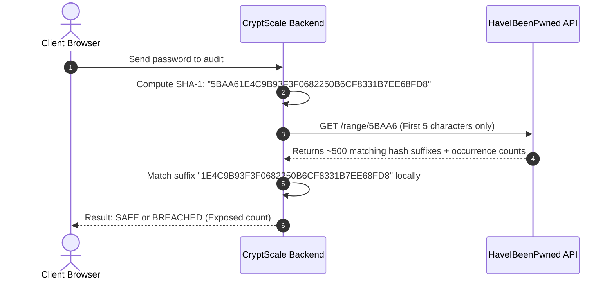

<div align="center">

# 🛡️ CryptScale
### Next-Gen Password Complexity Auditor & CSPRNG Security Engine

[](https://www.python.org/)
[](https://flask.palletsprojects.com/)
[](https://haveibeenpwned.com/)
[](LICENSE)

<p align="center">
  <b>Real-Time Entropy Analysis</b> • <b>GPU Crack-Time Estimation</b> • <b>CSPRNG Generator (8–20 chars)</b> • <b>HIBP Breach Detection</b>
</p>

---

</div>

## 📑 Table of Contents
- [🌟 Key Features](#-key-features)
- [🧠 The Science & Math Behind CryptScale](#-the-science--math-behind-cryptscale)
  - [1. Shannon Character-Pool Entropy ($H$)](#1-shannon-character-pool-entropy-h)
  - [2. GPU vs. Web Attack Crack-Time Estimation](#2-gpu-vs-web-attack-crack-time-estimation)
  - [3. Zero-Knowledge $k$-Anonymity Breach Verification](#3-zero-knowledge-k-anonymity-breach-verification)
- [🖥️ UI & Modules Breakdown](#️-ui--modules-breakdown)
  - [Module 1: Real-Time Password Auditor](#module-1-real-time-password-auditor)
  - [Module 2: Advanced CSPRNG Generator (8–20 Chars)](#module-2-advanced-csprng-generator-820-chars)
- [📁 Project Architecture](#-project-architecture)
- [🚀 Quickstart Guide](#-quickstart-guide)
- [💻 Command-Line Interface (CLI)](#-command-line-interface-cli)
- [🔌 REST API Documentation](#-rest-api-documentation)

---

## 🌟 Key Features

| Feature | Description |
| :--- | :--- |
| **🔍 Real-Time Auditor** | Evaluates password complexity on every keystroke with a circular score gauge and 5-segment glowing visual meter. |
| **⚡ Shannon Entropy Meter** | Computes true information-density bits based on dynamic character set expansion. |
| **💻 Crack-Time Simulator** | Accurately calculates offline high-speed GPU cluster ($10^{10}$ guesses/sec) and online throttled attack durations. |
| **🎲 Smart CSPRNG Generator** | Generates cryptographically secure passwords strictly bounded between **8 and 20 characters** with customizable symbol and ambiguous character filters. |
| **🛡️ HIBP Breach Scanner** | Queries over 800+ million compromised passwords using **$k$-Anonymity SHA-1** without exposing plain text. |
| **📊 Character Composition** | Live visual breakdown chart distinguishing lowercase, uppercase, digits, and special symbols. |

---

## 🧠 The Science & Math Behind CryptScale

### 1. Shannon Character-Pool Entropy ($H$)

Entropy measures the unpredictability of a password in bits:

$$H = L \times \log_2(R)$$

Where:
* $L$ = Length of the password string.
* $R$ = Size of the character pool based on active character classes:
  * Lowercase letters ($a-z$): $+26$
  * Uppercase letters ($A-Z$): $+26$
  * Numerical digits ($0-9$): $+10$
  * Special punctuation ($!@\#\$\dots$): $+32$
  * Whitespace: $+1$

#### 🎯 Tier Classifications:
```text
  [ 0 - 30 bits ]  --->  CRITICAL      (Crackable in milliseconds)
  [ 31 - 50 bits ] --->  WEAK          (Vulnerable to desktop GPUs)
  [ 51 - 70 bits ] --->  MODERATE      (Decent defense against casual attackers)
  [ 71 - 90 bits ] --->  STRONG        (Immune to single GPU clusters)
  [  91+ bits  ]   --->  VERY STRONG   (Cryptographically solid / Centuries+)
```

---

### 2. GPU vs. Web Attack Crack-Time Estimation

CryptScale models two distinct threat vectors:

1. **Offline GPU Brute-Force** ($\mathbf{10\text{ Billion guesses/sec}}$):
   $$\text{Seconds} = \frac{2^H}{10^{10}}$$
   Simulates dedicated hash-cracking rigs (e.g., Hashcat with multi-RTX 4090 arrays).

2. **Online Throttled Web Attack** ($\mathbf{100\text{ guesses/sec}}$):
   $$\text{Seconds} = \frac{2^H}{100}$$
   Simulates web login endpoints protected by rate limiting and firewalls.

---

### 3. Zero-Knowledge $k$-Anonymity Breach Verification

To ensure your password is **never exposed over the network**, CryptScale implements the industry-standard $k$-Anonymity protocol:



---

## 🖥️ UI & Modules Breakdown

### Module 1: Real-Time Password Auditor
* **Interactive Input**: Eye toggle for reveal/hide, single-click copy, and instant clear button.
* **Security Ring Gauge**: Dynamic circular SVG progress tracker mapped from $0\%$ to $100\%$.
* **6-Point Criteria Checklist**:
  * ✅ Minimum 8+ Characters
  * ✅ Optimal 12+ Characters
  * ✅ Lowercase ($a-z$)
  * ✅ Uppercase ($A-Z$)
  * ✅ Numbers ($0-9$)
  * ✅ Special Characters ($!@\#\$\dots$)
* **Actionable Guidance**: Contextual tips warning against keyboard patterns (`qwerty`, `123456`) and dictionary words.

### Module 2: Advanced CSPRNG Generator (8–20 Chars)
* **Precise Slider**: Strict bounds from **Min 8** to **Max 20** characters.
* **Instant Presets**: `8 (Min)`, `12 (Standard)`, `16 (Recommended)`, `20 (Maximum)`.
* **Rules & Filters**:
  * Toggle Uppercase, Lowercase, Numbers, and Symbols.
  * **Exclude Ambiguous**: Strips confusable glyphs like `1`, `l`, `I`, `0`, `O`, `|`.
* **Seamless Bridge**: Direct *"Audit in Detector"* button sends generated tokens straight to the Auditor.

---

## 📁 Project Architecture

```text
CryptScale/
├── templates/
│   └── index.html         # Semantic, responsive HTML5 dashboard interface
├── static/
│   ├── css/
│   │   └── style.css      # Cyberpunk glassmorphic design & ambient glowing effects
│   └── js/
│       └── app.js         # Reactive UI controller & REST client
├── CryptScale.py          # Core Python Flask API & CLI operations
├── requirements.txt       # Python package dependencies
└── README.md              # Technical documentation & project guide
```

---

## 🚀 Quickstart Guide

### Step 1: Clone or Open Workspace
```bash
cd CryptScale
```

### Step 2: Install Dependencies
```bash
pip install -r requirements.txt
```

### Step 3: Run the Application
```bash
python CryptScale.py
```

### Step 4: Open in Browser
Navigate to: **[http://127.0.0.1:5001](http://127.0.0.1:5001)**

---

## 💻 Command-Line Interface (CLI)

CryptScale can be used headlessly in scripts and CI/CD pipelines:

### 1. Audit a Password:
```bash
python CryptScale.py --check "Tr0ub4dor&3"
```

### 2. Audit + Breach Database Lookup:
```bash
python CryptScale.py --check "password123" --hibp
```

### 3. Generate a Very Strong Password (8 to 20 Chars):
```bash
# Default 16 characters
python CryptScale.py --generate

# Custom length (e.g. 20 characters)
python CryptScale.py --generate --length 20

# Without symbols
python CryptScale.py --generate --length 14 --no-symbols
```

---

## 🔌 REST API Documentation

### `POST /api/check`
Evaluates complexity, entropy, score, criteria, and composition.

### `POST /api/generate`
Generates a CSPRNG password between 8 and 20 characters with chosen entropy options.

### `POST /api/hibp`
Verifies breach status using the HaveIBeenPwned k-anonymity SHA-1 API.
